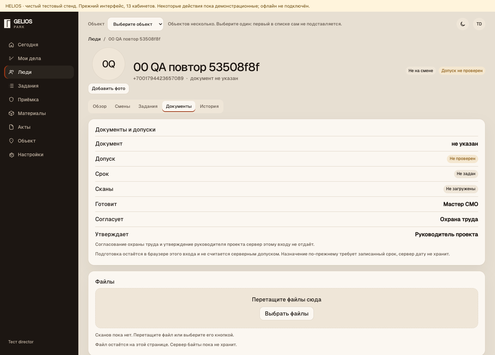
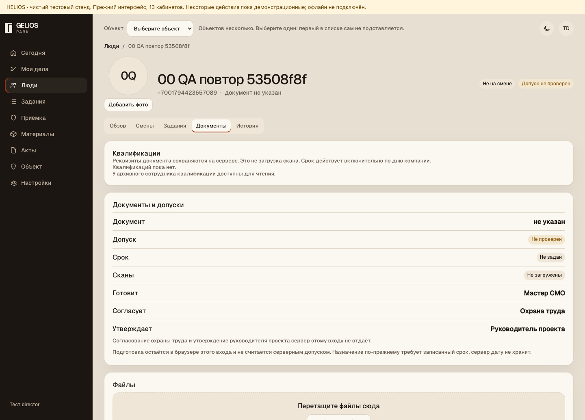

# R04 — квалификации сотрудника

Основа: main `21b4bde65988c0cc839dbda0d5d00dbb59da2a4b`, выпущенная с R01–R03. Ветка `codex/kvalifikatsii`; [PR #32](https://github.com/glebvin/helios/pull/32), задача [#4](https://github.com/glebvin/helios/issues/4). Реализация подготовлена к ревью, merge и новая выкладка не выполнялись.

## Поведение и контракт

В карточке «Люди → сотрудник → Документы» добавлен блок квалификаций в прежнем стиле. Чтение: `GET /api/v1/employees/:id/qualifications` с limit/offset; запись: POST туда же, PUT `/:qid`. Backend, OpenAPI, SQL и права не меняются.

- Director создаёт квалификацию: неизменяемый код, название, необязательные реквизиты и дата. Код связывает запись с будущими требованиями допуска. Реквизит не означает загруженный скан.
- Название, реквизиты, срок и отзыв редактируются с expectedVersion. Отозванную запись нельзя активировать; новое удостоверение с тем же кодом разрешено сервером, если активной записи с ним нет.
- Статус учитывает civil day компании из GET `/api/v1/overview`: дата включительна, null — без срока; истёкшая и отозванная записи не помечаются действующими. Это состояние квалификации, не утверждение допуска на объект.
- Запись подтверждается ответом API. При потере ответа повтор с тем же телом использует прежний requestId; метаданные неподтверждённой попытки сохраняются в sessionStorage этой вкладки с привязкой к компании/пользователю/сотруднику/записи. Серверные записи не заменяются локальными данными.
- Фоновое чтение не стирает черновик и не обновляет его expectedVersion. После stale_version есть отдельное явное чтение актуальной записи. Кнопки и поля блокируются на время команды.
- Ошибка отличается от пустого списка; есть повтор чтения. При отказе доступа записи скрываются. Архивный сотрудник доступен только для чтения. Другим основным ролям доступно разрешённое сервером чтение; дополнительные кабинеты сохраняют прежний вид.

## Проверено

Изолированные localhost PostgreSQL54349/API4357/production preview5207; только синтетические данные. Мутаций на активном стенде нет.

- TypeScript API/web/domain/offline, production build, ссылки документов — успешно.
- 17 frontend unit tests, включая включительный срок, отсутствие срока, отзыв, неизвестный день и различение ошибок — успешно.
- `qa/qualifications-browser.mjs`: 17 успешных проверок Chromium с настоящим API. Пустой ответ; потеря POST-ответа + reload без дубля с тем же requestId; срок по сегодня; новый authorized login; изменение срока;390px; конкурентная правка и сохранённый черновик; явное чтение и отзыв; refresh; новое удостоверение после отзыва; конфликт активного кода; сетевой отказ и retry; запрет записи/чужого сотрудника для master,worker,pto; разрешённое чтение master; пагинация27 записей.
- Регрессия `qa/staff-browser.mjs`: все7 проверок R02, включая дополнительные safety/hr/admin — успешно.
- Сравнены снимки одной карточки/роли/светлой темы/1440px; просмотрены список390px и форма отзыва. Данные снимков синтетические, сессии и пароли не публикуются.

Воспроизведение: подготовить отдельный контур R01–R03 с manifest13 ролей, organizationId и разрешёнными сотрудниками (учётные данные вне Git), затем:

```sh
PLAYWRIGHT_MODULE=/absolute/path/to/playwright/index.mjs \
CHROMIUM_EXECUTABLE=/absolute/path/to/chromium \
HELIOS_QA_CREDENTIALS=/private/path/to/qa-accounts.json \
HELIOS_QA_URL=http://127.0.0.1:5207 \
node qa/qualifications-browser.mjs
```

Скрипт запрещает мутационные проверки против внешнего hostname. Создаёт отдельного сотрудника и квалификации, существующие данные не сбрасывает. Unit tests входят в CI; браузерный прогон пока локальный.

## Снимки

| До | После — та же архивная карточка |
| --- | --- |
|  |  |

[Рабочие квалификации](assets/r04/qualifications.png) · [Список390px](assets/r04/mobile.png) · [Форма390px](assets/r04/form-mobile.png)

## Ограничения и откат

Независимого инженерного review и продуктового одобрения владельцем пока нет. Физические телефоны, Safari и полный offline не проверялись. Повтор команды сохраняется в той же вкладке, не между устройствами. Прежние блоки подготовки допуска/сканов остаются демонстрационными, что подписано в интерфейсе; их подключают следующие карточки. CI результат и точный head проверяются в PR.

Откат — отменить frontend-коммит R04. Миграций нет: серверные квалификации останутся в БД и доступны прежнему API. Сервер продолжает работать на frontend21b4bde; merge сам не выполняет deploy.
